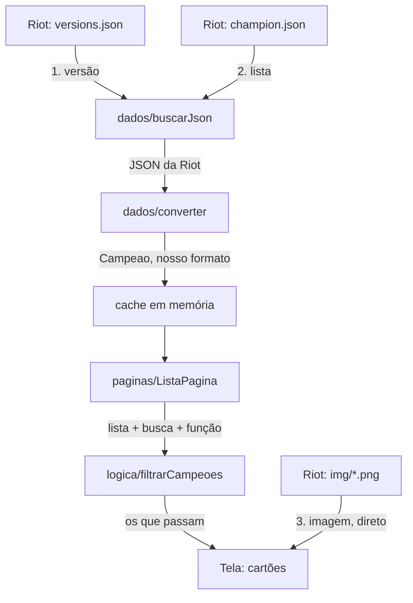

# Especificação: Explorador de Campeões

Data: 2026-11-13 · Estado: aguardando aprovação do Aryel

## 1. Objetivo e como saber que deu certo

Aplicação web para explorar os campeões de League of Legends: listar, buscar, filtrar, ver o detalhe, comparar dois
e guardar favoritos. Serve a dois fins: o Aryel **aprender** React e TypeScript e ter uma peça de **portfólio**.

Deu certo quando:

1. O site está publicado no GitHub Pages e cumpre o escopo da seção 2.
2. Cada item do escopo foi conferido rodando o site, e o que não foi verificado está escrito no README.
3. O Aryel consegue explicar, com as próprias palavras, qualquer arquivo e qualquer decisão do projeto.

## 2. Escopo

- **Lista** de campeões com retrato, busca por nome e filtro por função.
- **Detalhe** do campeão: história resumida, estatísticas base, passiva e habilidades Q, W, E e R com descrição e imagem.
- **Comparação** lado a lado das estatísticas base de dois campeões.
- **Favoritos** guardados no navegador.
- **Versão do jogo** visível, sempre a mais recente.
- Estados de **carregamento**, de **erro** e de **nada encontrado**.
- Responsivo (1440 px e 390 px), tema escuro, uso completo pelo teclado.
- **Aviso legal** visível em todas as páginas.

### Fora do escopo, de propósito

Skins, itens, runas, estatísticas por nível, outros idiomas, funcionamento sem rede e otimização para busca do Google.

## 3. Regras do projeto

| Assunto                    | Escolha                                                                                         |
| -------------------------- | ----------------------------------------------------------------------------------------------- |
| Kit `padroes-de-qualidade` | Serve de **guarda-corpo**, não de lista obrigatória: vale o que protege este projeto (seção 13) |
| Nomes no código            | Domínio em português (`filtrarCampeoes`); termos técnicos em inglês (`props`, `fetch`)          |
| Onde o Aryel escreve       | Na conversa; o Claude grava, roda e mostra a saída                                              |
| Tempo                      | Até 1 hora por dia; cerca de 22 sessões em 4 etapas (ver o plano)                               |
| Dado real                  | Só em execução, vindo do Data Dragon. O repositório não guarda nenhum dado nem imagem da Riot   |

## 4. Stack e decisões

O motivo e as alternativas de cada linha ficam em `docs/DECISOES.md`.

| Assunto           | Escolha                                                                                                                              | Alternativa principal descartada                                             |
| ----------------- | ------------------------------------------------------------------------------------------------------------------------------------ | ---------------------------------------------------------------------------- |
| Montagem          | Vite + React + TypeScript                                                                                                            | Next.js (traz conceitos de servidor que o projeto não tem)                   |
| Rotas             | React Router com `HashRouter`                                                                                                        | `BrowserRouter` com `404.html` (link direto responde 404 antes de funcionar) |
| Busca de dados    | `fetch` em `buscarJson`, com tempo limite de 10 s                                                                                    | TanStack Query (esconde o mecanismo que queremos aprender)                   |
| Cache             | `Map` em memória, por endereço                                                                                                       | `localStorage` (risco de dado velho)                                         |
| Formato dos dados | Próprio, convertido e validado na entrada, à mão                                                                                     | Formato da Riot direto; biblioteca Zod                                       |
| Estado            | Busca, filtro e comparação no endereço; favoritos em Context + `localStorage`                                                        | Tudo em `useState`; Redux                                                    |
| Estilo            | CSS Modules + um arquivo de variáveis                                                                                                | CSS global; Tailwind                                                         |
| Testes            | **Sem biblioteca de testes** (decisão de 2026-11-16). A lógica é conferida com exemplos de entrada e saída; as telas, rodando o site | Vitest + Testing Library (era o plano inicial)                               |
| Conferência       | Formatador + linter + `tsc` em `npm run conferir`                                                                                    | Sem linter; instalador e travas do kit                                       |
| Publicação        | Um workflow mínimo do GitHub Actions: instalar, build e publicar no GitHub Pages                                                     | Ramo `gh-pages`; Netlify                                                     |

## 5. Arquitetura



Regras da divisão:

- Só `dados/` fala com a rede. Só `dados/` conhece o formato da Riot.
- `logica/` tem funções puras: recebem valores, devolvem valores, não conhecem React.
- `paginas/` buscam dados e guardam estado. `componentes/` só recebem valores e mostram.

### Pastas

```text
src/
  dados/        enderecos, buscarJson, converter, tipos
  logica/       filtrarCampeoes, compararCampeoes, limparDescricao
  favoritos/    armazenamento no localStorage e o Context
  paginas/      ListaPagina, DetalhePagina, CompararPagina, NaoEncontradaPagina
  componentes/  CartaoCampeao, CampoBusca, FiltroFuncao, EstadoDaTela, BotaoFavorito,
                TabelaEstatisticas, CartaoHabilidade, SeletorCampeao, TabelaComparacao, AvisoLegal
  estilos/      variáveis de cor e tamanho, base global
docs/           DECISOES, MAPA-DE-ARQUIVOS, esta especificação e o plano
```

### Rotas

| Endereço                        | Página                    |
| ------------------------------- | ------------------------- |
| `/#/` e `/#/?q=kai&funcao=Mage` | Lista, com busca e filtro |
| `/#/campeao/:id`                | Detalhe                   |
| `/#/comparar?a=Ahri&b=Lux`      | Comparação                |
| Qualquer outro                  | Página não encontrada     |

## 6. Modelo de dados

```ts
type Funcao = "Assassin" | "Fighter" | "Mage" | "Marksman" | "Support" | "Tank";

type Estatisticas = {
  vida: number;
  mana: number;
  armadura: number;
  resistenciaMagica: number;
  danoDeAtaque: number;
  velocidadeDeAtaque: number;
  alcance: number;
  velocidadeDeMovimento: number;
};

type Campeao = {
  id: string; // "Belveth": usado no endereço
  nome: string; // "Bel'Veth": usado na busca
  titulo: string;
  resumo: string;
  funcoes: Funcao[];
  imagem: string; // endereço completo do retrato
  estatisticas: Estatisticas;
};

type Habilidade = {
  tecla: "P" | "Q" | "W" | "E" | "R";
  nome: string;
  descricao: string;
  imagem: string;
};

type CampeaoDetalhe = Campeao & { historia: string; habilidades: Habilidade[] };

type FavoritosGuardados = { versao: 1; ids: string[] };
```

A comparação usa as 8 estatísticas base, que já vêm na lista: a tela de comparar não faz chamada extra.

## 7. Comportamentos esperados

**Busca e filtro (`filtrarCampeoes`)**: ignora maiúsculas, acentos e pontuação ("kaisa" acha "Kai'Sa"); busca vazia
devolve todos; busca e função se combinam; campeão com duas funções aparece nas duas; a lista original não é alterada.

**Comparação (`compararCampeoes`)**: devolve uma linha por estatística, com os dois valores e quem tem o maior;
empate é empate; comparar um campeão com ele mesmo dá empate em tudo.

**Favoritos**: gravar e ler; `localStorage` bloqueado, vazio, corrompido ou de versão desconhecida vira lista vazia,
sem quebrar o app; id repetido não duplica.

**Erros e estados**

| Situação                                  | O que a pessoa vê                              |
| ----------------------------------------- | ---------------------------------------------- |
| Carregando                                | Cartões-fantasma no tamanho final              |
| Sem rede ou mais de 10 s                  | Mensagem em português e botão "Tentar de novo" |
| Resposta em formato inesperado            | Mensagem própria, com o mesmo botão            |
| Campeão inexistente (a Riot responde 403) | "Campeão não encontrado" e link para a lista   |
| Busca sem resultado                       | "Nada encontrado" e botão para limpar          |

## 8. Segurança e recursos de terceiros

- **Exceção consciente:** dados e imagens vêm de `https://ddragon.leagueoflegends.com` em tempo de execução. É a única
  origem externa. Nenhum outro CDN, fonte externa ou analytics.
- **CSP** em `<meta>` no `index.html`, liberando imagens e chamadas só para essa origem. Limitação: o GitHub Pages não
  permite cabeçalhos, e a CSP em `<meta>` cobre menos.
- **Dado de fora é texto:** as marcações das descrições são removidas; nunca `dangerouslySetInnerHTML`. Conferido com
  `<script>` e `` na fixture.
- **Resposta validada** antes do uso; **nenhuma chave** existe no projeto.
- **Dependências** conferidas no registro oficial antes de instalar.

## 9. Acessibilidade e visual

Elementos semânticos, `lang="pt-BR"`, texto alternativo nas imagens, rótulo em todo campo, foco visível, contraste
mínimo de 4,5:1, alvos de toque de 44 px, `prefers-reduced-motion` respeitado, `width` e `height` em toda imagem.
Tema escuro próprio, sem imitar o cliente do jogo e sem logos da Riot. Capturas em 1440 px e 390 px a cada tela.

## 10. Como conferimos, sem biblioteca de testes

Decisão do Aryel em 2026-11-16: o projeto não usa Vitest nem outra biblioteca de testes, e o CI é o menor possível.

- **Tipos e estilo:** `npm run conferir` roda o formatador, o linter e o compilador do TypeScript.
- **Lógica** (`filtrarCampeoes`, `compararCampeoes`, `limparDescricao`, conversão, favoritos): cada função tem uma
  tabela de exemplos (entrada e saída esperada) na ficha da tarefa, conferida à mão ao rodar.
- **Telas:** rodando o site, com capturas em 1440 px e 390 px, teclado e console sem erro.
- **CI:** um workflow só, que instala, faz o build e publica. Se o build falhar, nada vai ao ar.

O que se perde, de propósito: nenhuma conferência automática de comportamento. Uma mudança futura pode quebrar algo
sem aviso, e o README dirá isso.

## 11. Política da Riot

Lida em 2026-11-12 ("General Policies", atualizada em 2025-05-29, e "Legal Jibber Jabber"):

- Aviso obrigatório e visível, com o texto padrão de "isn't endorsed by Riot Games".
- Projeto gratuito; sem logos nem marcas da Riot; sem imitar os jogos em estilo ou função.
- **Em aberto:** se um projeto sem chave precisa de registro no Developer Portal. Reler antes de publicar.

## 12. Como ensinamos

Estilo de saída Professor do kit, mais o que o Aryel pediu para este projeto:

- **Tudo é explicado na primeira vez:** cada decisão, arquivo, linha de código, sintaxe, peça de arquitetura e de
  infraestrutura (git, npm, CI, GitHub Pages). Depois, "mesmo padrão de X" e só o que for novo.
- Antes de criar um arquivo: para que serve, por que naquela pasta, por que aquele nome, alternativas.
- Uma tarefa pequena por vez. Ao final, 1 ou 2 perguntas para o Aryel explicar de volta. Só avança com o aval dele.
- Tarefas **solo**: ficha, tabela de exemplos (entrada e saída esperada) e dicas em escada; a solução não é entregue.
- Erro ou tela em inglês: o Aryel diz primeiro o que entendeu.
- Ao fechar cada tarefa: `APRENDIZADOS.md` com resumo, dificuldade e de 3 a 5 termos em inglês.

## 13. O que usamos do kit, e o que fica de fora

Decisão do Aryel em 2026-11-13: o kit existe para o Claude não inventar nem afirmar sem provar. Não é para seguir
inteiro. O que está fora do escopo deste projeto é ignorado.

**Usamos**

- Verificar antes de afirmar, e dizer o que não foi verificado.
- Nenhum segredo nem dado real no repositório; dado de fora tratado como texto.
- Capturas em 1440 px e 390 px antes de dizer que a tela ficou boa.
- Conferir cada dependência no registro oficial antes de instalar.
- Formatador, linter e tipos em um comando só (`npm run conferir`).
- O jeito de ensinar (seção 12) e os documentos que o Aryel pediu: `CLAUDE.md`, `docs/DECISOES.md`,
  `docs/MAPA-DE-ARQUIVOS.md` e `APRENDIZADOS.md`.

**Fica de fora**

| Item do kit                                                                                         | Por que não entra                                                         |
| --------------------------------------------------------------------------------------------------- | ------------------------------------------------------------------------- |
| Instalador, hooks do Claude Code, trava do commit e arquivos de `.claude/`                          | Muita configuração para um projeto simples; nunca rodaram em projeto real |
| Revisão por subagente (`/conferir-codigo`) a cada tarefa                                            | O Claude revisa o código do Aryel na própria conversa                     |
| Checklist de pronto com evidência por item, cobertura mínima, Dependabot, CodeQL, `npm audit` no CI | Cerimônia de projeto maior                                                |
| Lighthouse no CI                                                                                    | Roda uma vez, à mão, no fim                                               |
| Seção 9A (busca do Google) e "legível sem JavaScript"                                               | Aplicação React com `#` no endereço; só um aviso em `<noscript>`          |
| Registrar todo erro no `ERROS.md` do kit                                                            | Só o erro que claramente se repetiria em outro projeto                    |

Outras escolhas conscientes: as capturas ficam fora do repositório, porque mostram arte da Riot; o Data Dragon é o
único recurso de terceiros (seção 8).

## 14. Ainda não verificado

- Registro no Developer Portal (seção 11).
- Nota 95 de desempenho no Lighthouse com 173 imagens.
- Se todo campeão tem exatamente quatro habilidades (um conferido).
- Versões exatas de React, Vite e React Router, conferidas na instalação.
