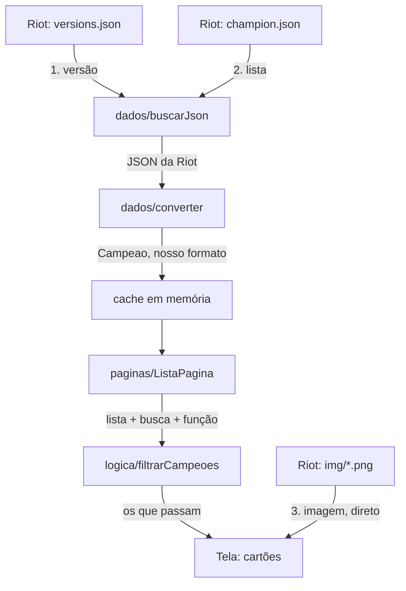

# Especificação: Explorador de Campeões

Data: 2026-11-13 · Estado: aguardando aprovação do Aryel

## 1. Objetivo e como saber que deu certo

Aplicação web para explorar os campeões de League of Legends: listar, buscar, filtrar, ver o detalhe, comparar dois
e guardar favoritos. Serve a dois fins: o Aryel **aprender** React e TypeScript e ter uma peça de **portfólio**.

Deu certo quando:

1. O site está publicado no GitHub Pages e cumpre o escopo da seção 2.
2. O `docs/CHECKLIST-PRONTO.md` do nível 1 está marcado, com a evidência de cada item.
3. O Aryel consegue explicar, com as próprias palavras, qualquer arquivo e qualquer decisão do projeto.

## 2. Escopo

- **Lista** de campeões com retrato, busca por nome e filtro por função.
- **Detalhe** do campeão: história resumida, estatísticas base, passiva e habilidades Q, W, E e R com descrição e imagem.
- **Comparação** lado a lado das estatísticas base de dois campeões.
- **Favoritos** guardados no navegador.
- **Versão do jogo** visível, sempre a mais recente.
- Estados de **carregamento**, de **erro** e de **nada encontrado**.
- Responsivo (1440 px e 390 px), tema escuro, uso completo pelo teclado.
- **Aviso legal** visível em todas as páginas.

### Fora do escopo, de propósito

Skins, itens, runas, estatísticas por nível, outros idiomas, funcionamento sem rede e otimização para busca do Google.

## 3. Regras do projeto

| Assunto | Escolha |
| --- | --- |
| Kit `padroes-de-qualidade` | Versão 0.11, **nível 1**, **ritmo completo**, **modo essencial** |
| Nomes no código | Domínio em português (`filtrarCampeoes`); termos técnicos em inglês (`props`, `fetch`) |
| Onde o Aryel escreve | Na conversa; o Claude grava, roda e mostra a saída |
| Tempo | Até 1 hora por dia; cerca de 25 sessões em 4 etapas (ver o plano) |
| Dado real | Só em execução, vindo do Data Dragon. Repositório e testes têm só campeões **inventados** |

## 4. Stack e decisões

O motivo e as alternativas de cada linha ficam em `docs/DECISOES.md`.

| Assunto | Escolha | Alternativa principal descartada |
| --- | --- | --- |
| Montagem | Vite + React + TypeScript | Next.js (traz conceitos de servidor que o projeto não tem) |
| Rotas | React Router com `HashRouter` | `BrowserRouter` com `404.html` (link direto responde 404 antes de funcionar) |
| Busca de dados | `fetch` em `buscarJson`, com tempo limite de 10 s | TanStack Query (esconde o mecanismo que queremos aprender) |
| Cache | `Map` em memória, por endereço | `localStorage` (risco de dado velho) |
| Formato dos dados | Próprio, convertido e validado na entrada, à mão | Formato da Riot direto; biblioteca Zod |
| Estado | Busca, filtro e comparação no endereço; favoritos em Context + `localStorage` | Tudo em `useState`; Redux |
| Estilo | CSS Modules + um arquivo de variáveis | CSS global; Tailwind |
| Testes | Vitest + Testing Library + jsdom, `fetch` trocado por dublê, axe | Jest; MSW |
| Conferência | Prettier + ESLint + `tsc` + testes em `npm run conferir` (kit, seção 4A) | Sem linter |
| Publicação | GitHub Actions para o GitHub Pages, só com o CI verde | Ramo `gh-pages`; Netlify |

## 5. Arquitetura



Regras da divisão:

- Só `dados/` fala com a rede. Só `dados/` conhece o formato da Riot.
- `logica/` tem funções puras: recebem valores, devolvem valores, não conhecem React.
- `paginas/` buscam dados e guardam estado. `componentes/` só recebem valores e mostram.

### Pastas

```text
src/
  dados/        enderecos, buscarJson, converter, tipos
  logica/       filtrarCampeoes, compararCampeoes, limparDescricao
  favoritos/    armazenamento no localStorage e o Context
  paginas/      ListaPagina, DetalhePagina, CompararPagina, NaoEncontradaPagina
  componentes/  CartaoCampeao, CampoBusca, FiltroFuncao, EstadoDaTela, BotaoFavorito,
                TabelaEstatisticas, CartaoHabilidade, SeletorCampeao, TabelaComparacao, AvisoLegal
  estilos/      variáveis de cor e tamanho, base global
  testes/       fixtures com campeões inventados e a trava de rede
docs/           DECISOES, MAPA-DE-ARQUIVOS, CHECKLIST-PRONTO, esta especificação e o plano
```

Cada teste fica ao lado do arquivo que testa (`filtrarCampeoes.test.ts`).

### Rotas

| Endereço | Página |
| --- | --- |
| `/#/` e `/#/?q=kai&funcao=Mage` | Lista, com busca e filtro |
| `/#/campeao/:id` | Detalhe |
| `/#/comparar?a=Ahri&b=Lux` | Comparação |
| Qualquer outro | Página não encontrada |

## 6. Modelo de dados

```ts
type Funcao = "Assassin" | "Fighter" | "Mage" | "Marksman" | "Support" | "Tank";

type Estatisticas = {
  vida: number;
  mana: number;
  armadura: number;
  resistenciaMagica: number;
  danoDeAtaque: number;
  velocidadeDeAtaque: number;
  alcance: number;
  velocidadeDeMovimento: number;
};

type Campeao = {
  id: string; // "Belveth": usado no endereço
  nome: string; // "Bel'Veth": usado na busca
  titulo: string;
  resumo: string;
  funcoes: Funcao[];
  imagem: string; // endereço completo do retrato
  estatisticas: Estatisticas;
};

type Habilidade = { tecla: "P" | "Q" | "W" | "E" | "R"; nome: string; descricao: string; imagem: string };

type CampeaoDetalhe = Campeao & { historia: string; habilidades: Habilidade[] };

type FavoritosGuardados = { versao: 1; ids: string[] };
```

A comparação usa as 8 estatísticas base, que já vêm na lista: a tela de comparar não faz chamada extra.

## 7. Comportamentos que os testes cobram

**Busca e filtro (`filtrarCampeoes`)**: ignora maiúsculas, acentos e pontuação ("kaisa" acha "Kai'Sa"); busca vazia
devolve todos; busca e função se combinam; campeão com duas funções aparece nas duas; a lista original não é alterada.

**Comparação (`compararCampeoes`)**: devolve uma linha por estatística, com os dois valores e quem tem o maior;
empate é empate; comparar um campeão com ele mesmo dá empate em tudo.

**Favoritos**: gravar e ler; `localStorage` bloqueado, vazio, corrompido ou de versão desconhecida vira lista vazia,
sem quebrar o app; id repetido não duplica.

**Erros e estados**

| Situação | O que a pessoa vê |
| --- | --- |
| Carregando | Cartões-fantasma no tamanho final |
| Sem rede ou mais de 10 s | Mensagem em português e botão "Tentar de novo" |
| Resposta em formato inesperado | Mensagem própria, com o mesmo botão |
| Campeão inexistente (a Riot responde 403) | "Campeão não encontrado" e link para a lista |
| Busca sem resultado | "Nada encontrado" e botão para limpar |

## 8. Segurança e recursos de terceiros

- **Exceção consciente:** dados e imagens vêm de `https://ddragon.leagueoflegends.com` em tempo de execução. É a única
  origem externa. Nenhum outro CDN, fonte externa ou analytics.
- **CSP** em `<meta>` no `index.html`, liberando imagens e chamadas só para essa origem. Limitação: o GitHub Pages não
  permite cabeçalhos, e a CSP em `<meta>` cobre menos.
- **Dado de fora é texto:** as marcações das descrições são removidas; nunca `dangerouslySetInnerHTML`. Teste com
  `<script>` e `` na fixture.
- **Resposta validada** antes do uso; **nenhuma chave** existe no projeto.
- **Dependências** conferidas no registro oficial antes de instalar; `npm audit` no CI.

## 9. Acessibilidade e visual

Elementos semânticos, `lang="pt-BR"`, texto alternativo nas imagens, rótulo em todo campo, foco visível, contraste
mínimo de 4,5:1, alvos de toque de 44 px, `prefers-reduced-motion` respeitado, `width` e `height` em toda imagem.
Tema escuro próprio, sem imitar o cliente do jogo e sem logos da Riot. Capturas em 1440 px e 390 px a cada tela.

## 10. Testes

TDD em toda lógica. Nenhum teste acessa a internet: uma trava faz qualquer `fetch` real falhar. Fixtures no formato
do catálogo, com campeões inventados. Teste que passa de primeira é quebrado de propósito. axe nos testes de
componente; Lighthouse em workflow separado, sem travar a publicação.

## 11. Política da Riot

Lida em 2026-11-12 ("General Policies", atualizada em 2025-05-29, e "Legal Jibber Jabber"):

- Aviso obrigatório e visível, com o texto padrão de "isn't endorsed by Riot Games".
- Projeto gratuito; sem logos nem marcas da Riot; sem imitar os jogos em estilo ou função.
- **Em aberto:** se um projeto sem chave precisa de registro no Developer Portal. Reler antes de publicar.

## 12. Como ensinamos

Estilo de saída Professor do kit, mais o que o Aryel pediu para este projeto:

- **Tudo é explicado na primeira vez:** cada decisão, arquivo, linha de código, sintaxe, peça de arquitetura e de
  infraestrutura (git, npm, CI, GitHub Pages). Depois, "mesmo padrão de X" e só o que for novo.
- Antes de criar um arquivo: para que serve, por que naquela pasta, por que aquele nome, alternativas.
- Uma tarefa pequena por vez. Ao final, 1 ou 2 perguntas para o Aryel explicar de volta. Só avança com o aval dele.
- Tarefas **solo**: ficha, testes prontos e dicas em escada; a solução não é entregue.
- Erro ou tela em inglês: o Aryel diz primeiro o que entendeu.
- Ao fechar cada tarefa: `APRENDIZADOS.md` com resumo, dificuldade e de 3 a 5 termos em inglês.

## 13. Desvios do kit

| Regra do kit | Desvio | Motivo |
| --- | --- | --- |
| Sem JavaScript o conteúdo continua legível | Só um aviso em `<noscript>` | Aplicação React depende de JavaScript |
| Seção 9A (busca do Google) | Não se aplica | Endereços com `#` e sem intenção de ser achado na busca |
| Capturas guardadas no repositório | Ficam fora dele | Mostram arte da Riot |
| Nenhum recurso de terceiros | Data Dragon liberado | É a fonte dos dados (seção 8) |

## 14. Ainda não verificado

- Registro no Developer Portal (seção 11).
- Nota 95 de desempenho no Lighthouse com 173 imagens.
- Modelos de Node do kit (CI, hooks, Dependabot) em um projeto real: este é o primeiro.
- Se todo campeão tem exatamente quatro habilidades (um conferido).
- Versões exatas de React, Vite e React Router, conferidas na instalação.
